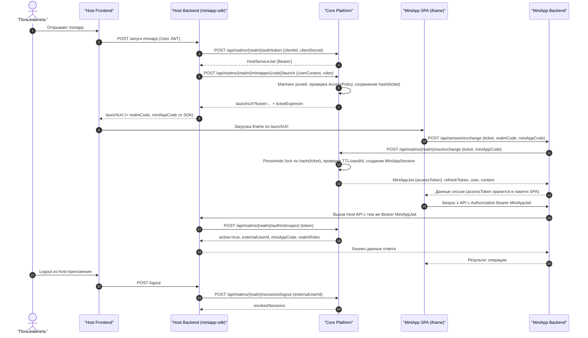

# Kemaless MiniApps Platform

Платформа для централизованного управления, контроля доступа и безопасного SSO-запуска встраиваемых miniapp-сервисов из внешних host-приложений.

> Происхождение проекта: платформа создана командой в рамках хакатона (оригинальный репозиторий с историей разработки команды: [kemalthes/miniapp-platform](https://github.com/kemalthes/miniapp-platform)). В текущем репозитории размещена сборка платформы с исправлениями конфигурации, безопасности и тестами.

## Назначение и решаемые задачи

Прямая интеграция каждого miniapp с каждым host-приложением приводит к дублированию авторизации, передаче лишних пользовательских данных через браузер и отсутствию единого механизма отзыва сессий. Платформа инкапсулирует эти задачи в иерархической модели `Platform -> Realm -> RealmClient -> RealmMiniApp`:

- **Единая B2B-интеграция для host-приложения**: host-бэкенд интегрируется с платформой один раз через `miniapp-sdk` по `realmCode + clientId + clientSecret` и получает доступ к каталогу опубликованных miniapp.
- **Маппинг ролей и политики доступа**: host-приложение передаёт свои внешние роли (`externalRoles`), платформа преобразует их в роли realm (`ExternalRoleMapping`) и проверяет `AccessPolicy` (`PUBLIC_IN_REALM`, `AUTHENTICATED`, `ROLE_BASED` с режимом `ANY` или `ALL`).
- **Безопасный SSO через одноразовый ticket**: в URL запуска передаётся только короткоживущий одноразовый `launch ticket` (хранится в БД в виде HMAC-SHA256 хеша, обмен выполняется под пессимистической блокировкой). Токены сессии в URL не попадают.
- **Сквозная проверка и отзыв сессий**: `MiniAppJwt` проверяется через introspection endpoint платформы, а logout пользователя на стороне host-приложения отзывает все его активные miniapp-сессии в рамках realm.
- **Наблюдаемость и AI Copilot**: аудит ключевых событий (`audit_events`), метрики запусков и отказов по realm/miniapp, опциональный RAG + AI-ассистент администратора на базе Spring AI, `pgvector` и MinIO.

## Архитектура компонентов

| Модуль | Стек | Назначение |
| --- | --- | --- |
| `core` | Java 21, Spring Boot 3.5.14, Spring Security, JPA, Liquibase, PostgreSQL (`pgvector`), MinIO, Spring AI 1.1.6 | Центральное ядро: админ-API, SSO/JWT/introspection, управление realms, ролями, политиками доступа, аудит и AI Copilot |
| `miniapp-sdk` | Java 21, Spring Boot 3.5.14 Starter (`RestClient`) | Библиотека автоконфигурации (`MiniAppPlatformClient`) для backend host-приложений: кеширование host-токена, каталог, launch, logout, introspect |
| `frontend` | React 18, TypeScript 5.9, Vite 7, Ant Design 6, TanStack Query, Zustand, Recharts | Web-панель администратора платформы: управление realms, клиентами, ролями, маппингом, miniapp, дашборд метрик и чат AI Copilot |
| `payment-miniapp` | Java 21, Spring Boot 3.5.14, Vanilla JS SPA | Демонстрационный платёжный miniapp: обмен launch ticket на miniapp-сессию через `/api/session/exchange`, CSP `frame-ancestors`, проксирование запросов в host API по Bearer JWT |
| `kemaless-bank` | Java 21, Spring Boot, React/Vite | Демонстрационное банковское host-приложение: интеграция с платформой через `miniapp-sdk`, встраивание miniapp в `<iframe>`, проверка miniapp-токенов через introspection |
| `gitops` | Prometheus, Alertmanager, Grafana, Loki, Tempo, OTel Collector, Alloy | Заготовки конфигураций observability-стека для развёртывания мониторинга и трассировки |

```mermaid
flowchart LR
    Admin["Администратор"] --> FE["frontend (React Admin UI)"]
    FE -->|Admin JWT /api/admin/**| Core["core (Spring Boot Platform)"]

    User["Пользователь"] --> BankUI["kemaless-bank UI"]
    BankUI -->|1. Запрос запуска miniapp| BankAPI["kemaless-bank Backend + miniapp-sdk"]
    BankAPI -->|2. B2B Auth, Catalog, Launch, Logout, Introspect| Core

    BankUI -->|3. iframe src = entryUrl?ticket=...| MiniAppUI["payment-miniapp SPA"]
    MiniAppUI -->|4. POST /api/session/exchange| MiniAppBFF["payment-miniapp Backend"]
    MiniAppBFF -->|5. POST /api/realms/{realm}/sso/exchange| Core
    MiniAppUI -->|6. API с MiniApp Bearer JWT| MiniAppBFF
    MiniAppBFF -->|7. Host API с MiniApp JWT| BankAPI

    Core --> PG["PostgreSQL 16 + pgvector"]
    Core --> MinIO["MinIO (Media S3)"]
    Core -.->|Optional LLM API| LLM["OpenAI-compatible API"]
```

## Интеграция host-приложения

### 1. Подготовка Realm и политик в платформе

1. Войдите в админ-панель (`frontend`) под учётной записью `ROOT` (создаётся при первом старте `core` из `PLATFORM_ADMIN_USERNAME` и `PLATFORM_ADMIN_PASSWORD`).
2. Создайте `Realm` (например, `bank`). При создании автоматически генерируется клиент по умолчанию (`clientId`, `clientSecret` показывается один раз).
3. Создайте роли realm (`RealmRole`, например `USER`, `PREMIUM_CLIENT`) и настройте соответствие внешних ролей host-приложения (`ExternalRoleMapping`: например, `CARD_OWNER -> USER`).
4. Зарегистрируйте `MiniApp` в глобальном каталоге, подключите его к `Realm` (`RealmMiniApp`), задайте `entryUrl` (например, `http://localhost:8091/start`), `AccessPolicy` и переведите статус в `PUBLISHED`.

Пример политики доступа:

```json
{
  "accessType": "ROLE_BASED",
  "roleMatchMode": "ANY",
  "requiredRoles": ["USER", "PREMIUM_CLIENT"]
}
```

### 2. Установка и настройка `miniapp-sdk`

Установите `miniapp-sdk` в локальный Maven-репозиторий:

```bash
cd miniapp-sdk
./mvnw clean install
```

Добавьте зависимость в `pom.xml` backend-сервиса host-приложения:

```xml
<dependency>
    <groupId>com.kemaless</groupId>
    <artifactId>miniapp-sdk</artifactId>
    <version>0.0.1-SNAPSHOT</version>
</dependency>
```

Настройте параметры подключения в `application.yaml` host-приложения:

```yaml
miniapp:
  platform:
    enabled: true
    url: http://localhost:8082
    realm-code: bank
    client-id: default-bank
    client-secret: ${MINIAPP_CLIENT_SECRET}
    connect-timeout: PT5S
    read-timeout: PT30S
```

`MiniappAutoConfiguration` зарегистрирует bean `MiniAppPlatformClient` с методами:

- `getCatalog()` — получить список опубликованных miniapp для realm (с кешированием host-токена и безопасными retry при временных 408/429/502/503/504);
- `launchMiniApp(miniAppCode, request)` — проверить политику доступа и получить `LaunchResult` (`launchUrl` с `ticket`, `realmCode`, `miniAppCode` и `ticketExpiresIn`);
- `introspectToken(token)` — проверить активность `MiniAppJwt` и получить `externalUserId`, `miniAppCode`, `realmRoles`;
- `logoutUser(externalUserId)` — отозвать все активные miniapp-сессии пользователя в realm.

## Последовательность SSO-аутентификации



## Подключение нового MiniApp

Чтобы miniapp безопасно работал с платформой и мог встраиваться в host-приложение:

1. **Точка входа и обмен тикета**: на маршруте запуска (`/start` или `/`) SPA извлекает `ticket`, `realmCode`, `miniAppCode` из query-параметров и отправляет их на свой backend (`POST /api/session/exchange`). Обмен тикета должен выполняться server-to-server через `POST /api/realms/{realmCode}/sso/exchange` в `core`.
2. **Хранение токенов**: не передавайте `accessToken`/`refreshToken` в URL и не сохраняйте их в `localStorage` без необходимости; в `payment-miniapp` `accessToken` хранится только в оперативной памяти страницы.
3. **Встраивание в `<iframe>`**: настройте заголовок `Content-Security-Policy: frame-ancestors 'self' <host-ui-origin>` и CORS для разрешённых origin host-приложения (`miniapp.web-security.*` в `payment-miniapp`).
4. **Диагностика и метаданные**: `payment-miniapp` предоставляет `/api/health` и манифест контракта `/api/miniapp/manifest` (`/.well-known/miniapp.json`).
5. **Ограничение доступа на стороне Host API**: при приёме `MiniAppJwt` через introspection обязательно проверяйте `introspection.isActive()` и допустимый `miniAppCode` (см. `bank.miniapp-api.allowed-codes` в `kemaless-bank`).

## Локальный запуск

### Требования

- JDK 21
- Docker и Docker Compose
- Node.js 20+ и pnpm (или npm; для сборки/запуска `frontend` и UI `kemaless-bank` в репозитории зафиксирован `pnpm-lock.yaml`)
- Встроенные Maven Wrapper (`./mvnw` / `mvnw.cmd`) в каждом Java-модуле

### 1. Запуск базовой инфраструктуры и `core`

1. Подготовьте корневой `.env` на основе шаблона:

```bash
cp .env.sample .env
```

> Внимание: при использовании `.env` порт `core` на хосте задаётся через `SERVER_PORT=8082` (чтобы не конфликтовать с `kemaless-bank` на `8080`). Без `.env` `docker-compose.yml` публикует `core` на `8080`. Перед любым внешним деплоем замените демонстрационные пароли и `PLATFORM_BACKEND_SECRET_KEY` (минимум 32 байта).

2. Соберите `miniapp-sdk` и JAR для `core`:

```bash
cd miniapp-sdk && ./mvnw clean install -DskipTests && cd ..
cd core && ./mvnw clean package -DskipTests && cd ..
```

3. Поднимите `core`, PostgreSQL (`pgvector/pgvector:pg16`) и MinIO:

```bash
docker compose up --build -d
```

Или воспользуйтесь `Makefile`:
- `make build` — сборка Java-модулей (`miniapp-sdk`, `core`, `payment-miniapp`, `kemaless-bank`);
- `make up` / `make down` / `make logs` / `make ps` — управление базовым `docker-compose.yml`.

Доступные адреса после старта `docker compose`:
- Core API: `http://localhost:8082` (или `8080`, если `SERVER_PORT` не задан)
- PostgreSQL (`pgvector`): `localhost:15432` (`POSTGRES_PORT`)
- MinIO API / Console: `http://localhost:9000` / `http://localhost:9002`

### 2. Запуск панели администратора (`frontend`)

```bash
cd frontend
cp .env.sample .env
pnpm install --frozen-lockfile
pnpm run dev
```

По умолчанию `frontend/.env.sample` указывает `VITE_API_BASE_URL=http://localhost:8082`. Для входа используйте учётные данные из `PLATFORM_ADMIN_USERNAME` и `PLATFORM_ADMIN_PASSWORD`.

### 3. Запуск сквозного демо-стенда (`kemaless-bank` + `payment-miniapp`)

1. Запустите БД банка (или используйте существующий PostgreSQL с отдельной базой):

```bash
docker compose -f kemaless-bank/docker-compose.yaml up -d
```

2. Сконфигурируйте в админ-панели `core` realm (например, `bank`), сохраните `clientId`/`clientSecret`, создайте роль и маппинг, подключите и опубликуйте miniapp с `entryUrl=http://localhost:8091/start`.
3. Задайте в окружении параметры `MINIAPP_*`, `PLATFORM_BASE_URL`, `BANK_*` (ориентир — `.env.sample`) и запустите:
   - `kemaless-bank` backend (порт `8080`) и `kemaless-bank/frontend` (`http://localhost:5174`);
   - `payment-miniapp` (порт `8091`).

### 4. Проверка тестов без Docker

```bash
cd core && ./mvnw test
cd ../miniapp-sdk && ./mvnw test
cd ../payment-miniapp && ./mvnw test
```

## Известные ограничения

- **Состав `docker-compose.yml`**: в текущем Compose-файле описаны `admin-platform` (`core`), `postgres` (`pgvector/pgvector:pg16`) и S3-совместимое хранилище (`pgsty/silo:RELEASE.2026-11-12T00-00-00Z`, pinned multi-arch замена удалённого `minio/minio:latest`; альтернативы — `bitnamilegacy/minio:2025.7.23-debian-12-r5` или `rustfs/rustfs:1.0.7` с адаптацией конфигурации; также медиа-модуль можно отключить через `PLATFORM_AI_MEDIA_ENABLED=false`). `frontend`, `payment-miniapp`, `kemaless-bank` и стек мониторинга запускаются отдельно.
- **Observability-конфиги в `gitops/observability/`**: директория содержит заготовки для Prometheus, Alertmanager, Grafana, Loki, Tempo, OTel Collector и Alloy, не подключённые в `docker-compose.yml`; часть правил и дашбордов сохранила шаблонное именование (`delivery-monolith`) и требует адаптации перед production-использованием.
- **Незавершённый endpoint телеметрии в `miniapp-sdk`**: метод `MiniAppPlatformClient.trackEvent(...)` обращается к `POST /api/realms/{realmCode}/miniapps/{miniAppCode}/events`, который не реализован в `core`.
- **Аутентификация introspection endpoint**: `POST /api/realms/{realmCode}/auth/introspect` в текущей версии публично доступен в `SecurityConfig` в соответствии с контрактом `miniapp-sdk`; в production этот endpoint должен быть ограничен по сети или требовать аутентификацию клиента realm.
- **Обязательность `externalUserId` для `launch_tickets`**: в схеме БД `launch_tickets.external_user_id` задано `NOT NULL`, поэтому при запуске miniapp с политикой `PUBLIC_IN_REALM` host-приложению необходимо передавать идентификатор субъекта/анонимной сессии.
- **Начальные mock-данные во `frontend`**: часть Zustand-сторов и страница предпросмотра `LaunchPage` содержат статические mock-массивы, используемые до загрузки реальных данных с backend или для демонстрационного превью.
- **Опциональный AI Copilot / RAG**: для работы чата и индексации в `pgvector` требуется внешний OpenAI-compatible endpoint и ключ (`SPRING_AI_OPENAI_SDK_API_KEY`), а также включение `PLATFORM_AI_COPILOT_ENABLED=true` и `PLATFORM_AI_RAG_ENABLED=true`.
- **Лицензия**: файл `LICENSE` отсутствует, так как исходный проект разрабатывался командой без опубликованной open-source лицензии.
